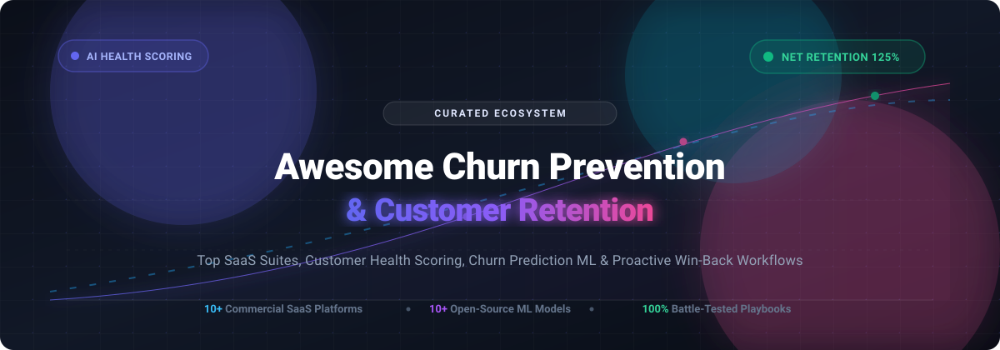

# Awesome Churn Prevention & Customer Retention 🎯

  

> 💡 **A curated directory of top SaaS platforms, customer success suites, and open-source machine learning frameworks dedicated to customer retention, churn prevention, predictive health scoring, and automated win-back workflows.**

  
  
  
  
  
  

---

Understanding customer behavior, predicting churn risks before cancellation occurs, and orchestrating proactive retention campaigns are vital imperatives for recurring-revenue and subscription-first businesses. This resource directory tracks both commercial enterprise SaaS suites and community open-source repositories to help product managers, data scientists, customer success managers (CSMs), and developers build reliable retention engines. 🚀

---

## 📑 Table of Contents
- [📊 Sector Overview & Market Dynamics](#-sector-overview--market-dynamics)
- [🏢 SaaS & Commercial Retention Platforms](#-saas--commercial-retention-platforms)
- [💻 Open-Source GitHub Projects](#-open-source-github-projects)
- [📐 Key Retention & Churn Metrics](#-key-retention--churn-metrics)
- [🤝 How to Contribute](#-how-to-contribute)
- [⭐ Star History](#-star-history)
- [💖 Support & Sponsorship](#-support--sponsorship)
- [⚖️ License & Disclaimer](#️-license--disclaimer)

---

## 📊 Sector Overview & Market Dynamics

The global customer success and churn prevention software market is estimated at **$2.6B–$2.9B** and is projected to expand at a compound annual growth rate (**CAGR of 15%–22%**) toward **$6B–$8B+** by the early 2030s, fueled by the widespread adoption of SaaS, cloud infrastructure, and recurring billing models. 📈

The sector exhibits **moderate fragmentation with ongoing consolidation**: established CRM giants (Salesforce, Zendesk) and category leaders (Gainsight, Chargebee, Totango/Catalyst) anchor the high-end enterprise segment, while an active, competitive ecosystem of specialized mid-market platforms and micro-SaaS dunning/cancellation-flow tools compete aggressively on self-serve onboarding, AI agent automation, and flexible pricing. 🌐

---

## 🏢 SaaS & Commercial Retention Platforms

Below is an overview of major commercial customer retention and churn management platforms, ranked in descending order of company scale (valuation / funding / revenue size). 💼

| Product | Company Scale (Valuation / Revenue) | Description | Starting Pricing | Free Tier / Trial Limits |
| :--- | :--- | :--- | :--- | :--- |
| **[Chargebee Retention](https://www.chargebee.com/)** | **$3.5B valuation** (~$470M raised) | Retention & cancellation-flow engine within Chargebee's subscription management suite; offers deflection flows, dynamic save offers, session analytics, and smart dunning. | **$250/month** (Starter tier for 50–149 cancellation sessions/mo) | **30-day free trial** with full cancel-flow testing features; no permanent free tier. |
| **[ProfitWell Retain](https://www.paddle.com/retain)** | **$1.4B valuation** ($200M+ acquisition by Paddle) | Pay-for-performance churn recovery system specializing in involuntary payment recovery, algorithmic retries, and automated dunning campaigns. | **$500/month** flat base floor for smaller teams (or 10%–15% performance fee of recovered revenue for larger volumes) | **Free forever plan** for *ProfitWell Metrics* (revenue and churn analytics); *Retain* module has no separate free tier (requires sales/Paddle billing setup). |
| **[Gainsight CS](https://www.gainsight.com/)** | **$1.1B valuation** (~$200M+ ARR, acquired by Vista Equity) | Industry-leading enterprise customer success platform providing multi-dimensional customer health scores, 360-degree account intelligence, and journey orchestration playbooks. | **$1,200/user/year** (~$100/seat/month; base implementations typically start at $12,000–$30,000/year contract) | **15-day free trial** available for Gainsight PX; **No self-serve free trial** for Gainsight CS (guided demo and sales-assisted POC required). |
| **[Planhat](https://www.planhat.com/)** | **~$540M valuation** ($50M Series A, ~$30M ARR) | Modern customer platform featuring custom health scores, dynamic usage dashboards, customer portals, and unlimited internal team collaborator seats. | **$1,150/month** (billed annually, ~$13,800/year base tier) | **No self-serve free trial** and no free tier; custom guided sandbox/proof-of-concept provided upon demo qualification. |
| **[Totango](https://www.totango.com/)** | **~$300M+ scale** ($100M+ Series D, merged with Catalyst) | Modular customer success software with composable success blocs, automated health tracking, journey triggers, and early warning systems. | **$199/month** (Enterprise/Growth packages start at ~$1,000/month or $12,000/year) | **Free forever Community Edition**: includes up to 3 user seats, 100 customer accounts, and 1,000 customer emails/month; 30-day trial for enterprise tiers. |
| **[Vitally](https://www.vitally.io/)** | **~$150M–$250M valuation** ($40M raised from a16z, Next47) | Collaborative customer success platform integrating account intelligence, AI copilots, customer productivity docs, and lifecycle automation for high-growth SaaS teams. | **$299/month** (Growth/Enterprise tiers scale based on managed account volume) | **30-day free trial** for select add-on modules (email services/goals); **No self-serve free trial** for core CSP (custom sandbox upon sales demo). |
| **[ChurnZero](https://churnzero.com/)** | **~$35M funding** (~$27M–$45M estimated ARR) | Customer success management software tailored for subscription companies with real-time in-app walkthroughs, account health tracking, and renewal forecasts. | **$1,000/month** (billed annually at $12,000/year starting tier based on account volume) | **No free tier and no self-serve free trial**; evaluation requires a scheduled consultation and customized sales demonstration. |
| **[Custify](https://www.custify.com/)** | **~$2.7M ARR** (Bootstrapped, team of ~35) | Customer success solution purpose-built for B2B SaaS businesses to automate onboarding tracking, churn warning triggers, and client engagement. | **$899/month** (entry tier covering up to 3 CSM seats and full core automation) | **No permanent free tier and no public self-serve free trial**; personalized 1-on-1 guided live demo available on request. |
| **[Churnkey](https://churnkey.co/)** | **~$1.7M ARR** ($1.5M funding raised) | Retention automation suite featuring personalized cancellation flows, AI exit surveys, failed payment recovery dunning, and customer health score insights. | **$250/month** (Starter tier for up to $5,000 monthly churned volume; $300/mo on monthly billing) | **14-day free trial** with full access to cancellation flows and dunning; no credit card required upfront. Includes standalone free churn metric tracker. |
| **[ProsperStack](https://prosperstack.com/)** | **Bootstrapped / Early Stage** (Lean team of ~15) | Churn management tool connecting cancellation deflection funnels, custom exit surveys, dynamic coupon offers, and pause-subscription workflows to Stripe. | **$200/month** (Grow tier covering up to 50 cancellation sessions/month; overages at $75 per 50 sessions) | **14-day free trial** for testing cancel-flow widgets; access initiated through onboarding demo request. No permanent free tier. |
| **[Churnfree](https://churnfree.com/)** | **Indie Micro-SaaS** (<$500K ARR) | User-friendly retention and cancellation flow manager providing churn surveys, pause subscription offers, and retention discount incentives. | **$49/month** (Basic tier for 1 website, 1 active cancellation workflow, and 5 dynamic offers) | **14-day free trial** with all features included; no credit card required at registration. |

---

## 💻 Open-Source GitHub Projects

Explore community-driven, self-hosted machine learning models, clickstream journey analytics libraries, and churn prediction web applications. Repositories are sorted in descending order of GitHub Stars_Count. 🌟

| Project | Stars_Badge | Primary Language / Stack | Description |
| :--- | :--- | :--- | :--- |
| **[Retentioneering Tools](https://github.com/retentioneering/retentioneering-tools)** |  | Python (Pandas, NetworkX, Scikit-Learn) | Comprehensive clickstream product analytics and customer journey mapping toolkit. Enables behavioral segmentation, conversion funnel visualization, graph-based user flow analysis, Markov chain churn simulation, and retention cohort modeling. |
| **[WTTE-RNN](https://github.com/ragulpr/wtte-rnn)** |  | Python (TensorFlow, Keras) | *Weibull Time To Event Recurrent Neural Network*—a machine learning framework specifically engineered for churn prediction and event-timing estimation with censored duration data. |
| **[Customer Survival Analysis & Churn Prediction](https://github.com/archd3sai/Customer-Survival-Analysis-and-Churn-Prediction)** |  | Python (Flask, Lifelines, Scikit-Learn) | End-to-end customer survival analysis model measuring how churn risk probabilities evolve over time, combined with Random Forest classification and expected Customer Lifetime Value (CLTV) calculation. |
| **[Telecom Churn Prediction ML Pipeline](https://github.com/Pradnya1208/Telecom-Customer-Churn-prediction)** |  | Python (Jupyter, Scikit-Learn, Plotly) | Classification pipeline predicting customer churn behavior using cross-validated algorithms, feature importance rankings, and ROC-AUC curve comparisons. |
| **[Credit Card Customer Churn Classifier](https://github.com/allmeidaapedro/Churn-Prediction-Credit-Card)** |  | Python (LightGBM, Imbalanced-Learn, SMOTE) | Complete machine learning project using LightGBM and SMOTE resampling techniques to detect at-risk banking and credit card customers for targeted retention offers. |
| **[End-to-End Customer Churn Prediction](https://github.com/rahuloraj/Customer-Churn-Prediction)** |  | Python (Scikit-Learn, Pandas) | Production-style ML pipeline implementing data preprocessing, exploratory data analysis, and Random Forest classification to forecast customer defection rates. |
| **[Bank Customer Churn Dashboard](https://github.com/zunicd/Bank-Churn-Prediction)** |  | Python (Streamlit, XGBoost, Scikit-Learn) | Interactive web application comparing predictions across multiple supervised learning models to provide real-time churn risk indicators and profile insights. |
| **[PySpark Churn Prediction](https://github.com/bensadeghi/pyspark-churn-prediction)** |  | Python (Apache Spark MLlib, PySpark) | Scalable churn analysis pipeline capable of distributed model training on large datasets using Spark MLlib classification algorithms. |
| **[ChurnShield App](https://github.com/bijay-odyssey/ChurnShield-App)** |  | Python (Flask, Scikit-Learn) | Web app powered by a Random Forest ML pipeline that computes individual churn probability and recommends personalized retention playbooks; includes admin auth and CSV history exports. |
| **[Churn Risk Detection Agent](https://github.com/AdityaKuranjekar/Churn-risk-detection-agent)** |  | Python (FastAPI, XGBoost, SHAP, RAG) | AI-powered Customer Success Agent combining dual-engine risk scoring (XGBoost + SHAP model and health scoring) with RAG-based playbook retrieval and human-in-the-loop outreach drafting. |

---

## 📐 Key Retention & Churn Metrics

When implementing retention infrastructure, tracking standardized benchmarks ensures alignment across teams: 📊

* **Customer Churn Rate (Logo Churn)**:
  $$\text{Logo Churn Rate} = \frac{\text{Customers Lost in Period}}{\text{Total Customers at Start of Period}} \times 100$$
* **Net Revenue Retention (NRR)**:
  $$\text{NRR} = \frac{\text{Starting ARR} + \text{Expansion} - \text{Contraction} - \text{Churn ARR}}{\text{Starting ARR}} \times 100$$
* **Gross Revenue Retention (GRR)**:
  $$\text{GRR} = \frac{\text{Starting ARR} - \text{Contraction} - \text{Churn ARR}}{\text{Starting ARR}} \times 100$$
* **Customer Lifetime Value (LTV)**:
  $$\text{LTV} = \frac{\text{Average Revenue Per Account (ARPA)} \times \text{Gross Margin}}{\text{Customer Churn Rate}}$$

---

## 🤝 How to Contribute

We welcome additions from software creators, practitioners, and data scientists! 💡 To submit a new tool or open-source library:

1. **Fork** this repository.
2. Create a descriptive feature branch (`git checkout -b add-tool-name`).
3. Add the project in the appropriate table adhering to the established schema (ensure specific starting pricing and precise trial/free tier limits for SaaS; include social Stars_Badge linked to stargazers for open source).
4. Verify all hyperlinks and Markdown formatting.
5. Submit a **Pull Request** detailing why the tool belongs in this ecosystem.

---

## ⭐ Star History

---

## 💖 Support & Sponsorship

Thank you for visiting and supporting this curated resource! 🌟 If you found this repository helpful for your product, engineering, or customer success workflows, please consider:

- ⭐ **Starring** the repository on GitHub
- 🍴 **Forking** and contributing new tools or playbooks
- 📢 **Sharing** with colleagues, founders, and retention engineers
- ☕ **Buying a coffee / sponsoring** the ongoing maintenance on the [GitHub Sponsors Dashboard](https://github.com/sponsors/ishandutta2007)

Your support keeps this collection actively maintained, accurate, and vendor-neutral! 🙌

---

## ⚖️ License & Disclaimer

- Distributed under the [MIT License](LICENSE).
- **Disclaimer**: This compilation is community-maintained for informational and research purposes. Product names, logos, valuations, and trademarks are the property of their respective owners. Churn management often handles personally identifiable customer data; verify that all production integrations comply with regulatory frameworks (GDPR, CCPA, SOC 2).
